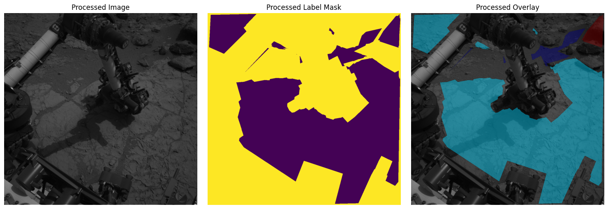
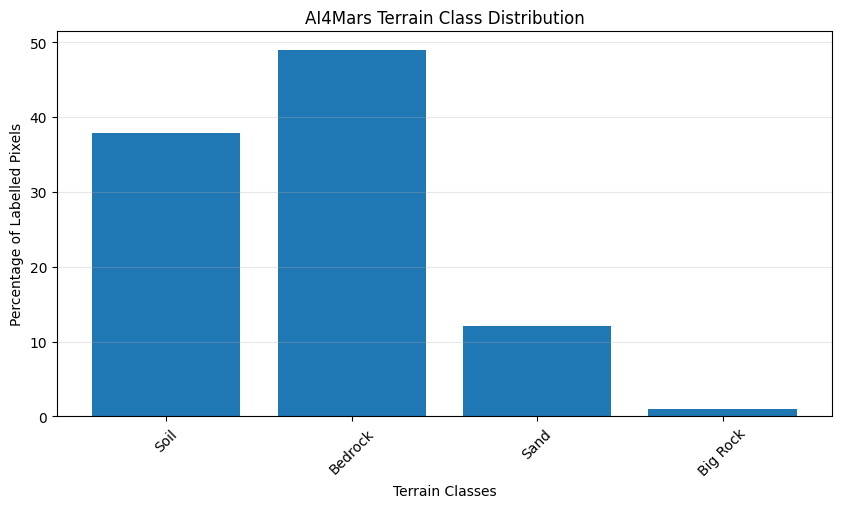
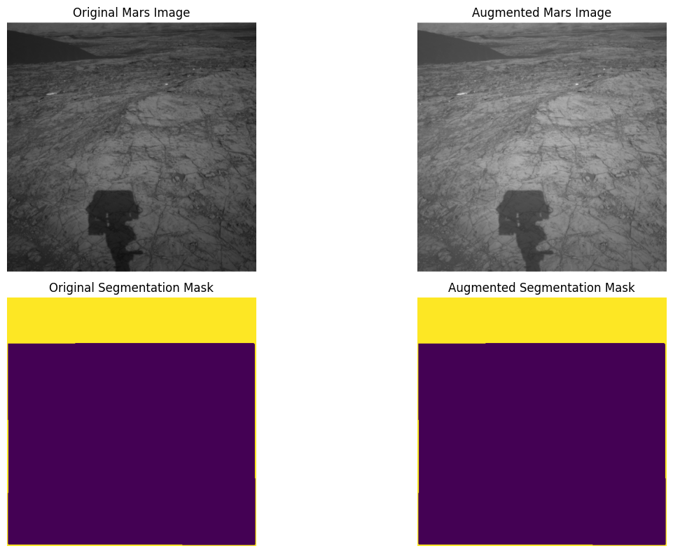
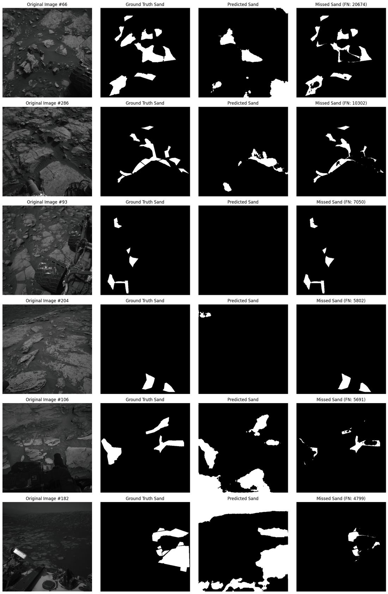

# Mars Rover Terrain Segmentation

[](https://colab.research.google.com/github/Ayush-aw4/Mars_Rover_Terrain_Segmentation/blob/main/Mars_Rover.ipynb)


**A deep-learning model that labels every pixel of a Mars rover photo as soil, bedrock, sand or big rock, the information a rover needs to plan a safe drive.**

Trained on NASA JPL's [AI4Mars](https://huggingface.co/datasets/hassanjbara/AI4MARS) dataset (Curiosity rover images) and tested on expert-labelled images the model never saw. Everything about the model lives in one notebook: [`Mars_Rover.ipynb`](Mars_Rover.ipynb).

> **Research prototype.** This is an educational project, not a flight-certified navigation system.

## Results at a glance

Measured on the expert-labelled test sets (322 images each), using only pixels the experts labelled:

| Test set | Mean IoU | Sand IoU | Pixel accuracy | "Everything is soil" baseline (mean IoU) |
| :--- | :---: | :---: | :---: | :---: |
| `test_min3` (most reliable labels) | **78.51%** | **89.13%** | 95.95% | 12.84% |
| `test_min1` (hardest, least strict) | **64.50%** | **80.65%** | 90.67% | 11.47% |

- Mean IoU is **6x higher** than the all-soil baseline on `test_min3`.
- Sand, the terrain that matters most for safe driving, is found well: on `test_min3` the model catches **98.38%** of true sand pixels.
- **Big Rock is the weak spot** (37.80% IoU on `test_min3`, 9.74% on `test_min1`). It is very rare in the data, so treat that number as noisy. More in [Limitations](#limitations-and-honest-notes).

<details>
<summary><b>New to segmentation? How to read these metrics</b></summary>

- **IoU (Intersection over Union)** is, for one class, the overlap between predicted and true pixels divided by their combined area. 100% is perfect, 0% means no overlap.
- **Mean IoU (mIoU)** is the plain average of the four class IoUs, so a rare class like Big Rock counts as much as common soil.
- **Pixel accuracy** is the share of labelled pixels classified correctly. It looks great even for a lazy model when one class dominates, which is why IoU is the headline number here.
</details>

## Why sand matters

Soft sand is what trapped NASA's Spirit rover. A rover that can tell sand from firm soil and bedrock can route around it. That is why this project measures sand separately and runs a dedicated [sand error analysis](#step-10-sand-error-analysis).

## The data

| | |
| :--- | :--- |
| Source | NASA JPL AI4Mars, Hugging Face mirror `hassanjbara/AI4MARS` (Curiosity images) |
| Images | 1024 x 1024 grayscale in the examples inspected, converted to 3-channel RGB for the model |
| Training split | 18,130 images, of which **16,064 have labels** and 2,066 have none |
| Test splits | `test_min3` and `test_min1`, 322 expert-labelled images each |
| Each row | image, `label_mask`, `rover_mask` (the rover's own body), `range_mask` (more than 30 m away) |
| Label values | `0` soil, `1` bedrock, `2` sand, `3` big rock, `255` no label |

Volunteers labelled only parts of each image, so most pixels carry no label. In the first example image, **58.21%** of pixels were unlabelled. Unlabelled pixels are excluded from the loss and from every metric.



*Left: rover image. Middle: label mask (yellow = unlabelled, value 255). Right: the labelled regions overlaid on the image.*

## The pipeline, step by step

Each step below matches a section of the notebook, so you can follow along in order.

### Step 1: Load and explore the data

The dataset is first opened in streaming mode to inspect one labelled row, its columns and its mask values, and to draw the labels in colour on top of the image. Palette used everywhere (notebook and app): soil `[164,117,74]`, bedrock `[120,130,140]`, sand `[238,190,70]`, big rock `[220,60,60]`.

### Step 2: Apply the rover and range masks

The labelers were told to ignore the rover's body and anything beyond 30 m, so those regions are never trustworthy. A `prepare(row)` function converts the image to RGB, flattens the label mask to one channel and sets every pixel inside either mask to `255` (ignore). It was checked on a tiny hand-made 2 x 3 example with an `assert` before being used on real data.

On the first example image no labelled pixels fell inside the masks, so they changed nothing there. They stay in the pipeline as a safety net.

### Step 3: Hold out a validation set

Images without labels are dropped (18,130 to 16,064), then split 90/10 with `seed=42`:

| Split | Images |
| :--- | :---: |
| Training | 14,457 |
| Validation | 1,607 |
| Expert test (`test_min3`, `test_min1`) | 322 each, untouched until the final evaluation |

### Step 4: Measure class imbalance and compute class weights

Pixels were counted over the first 2,000 training images, and each class got a loss weight of `1 - share`, as the AI4Mars authors did. Rare classes therefore count more.

| Class | Labelled pixels | Share | Loss weight |
| :--- | ---: | :---: | :---: |
| Soil | 437,751,231 | 37.87% | 0.6213 |
| Bedrock | 566,301,634 | 48.99% | 0.5101 |
| Sand | 139,817,179 | 12.10% | 0.8790 |
| Big Rock | 11,983,703 | 1.04% | 0.9896 |



In this data bedrock is the largest class, with soil second. Big rock is only about 1% of labelled pixels.

### Step 5: Build the "everything is soil" baseline

Predicting soil for every pixel gives a floor to beat. On the validation set it scores 37.84% soil IoU and **0% on the other three classes**, for a mean IoU of 9.46%. On the expert tests the baseline mean IoU is 12.84% (`test_min3`) and 11.47% (`test_min1`).

### Step 6: Build the data pipeline

- **Resize to 512 x 512.** Images use bilinear interpolation. Masks use **nearest-neighbour**, because bilinear would invent in-between values that belong to no class. A check confirms the resized masks only contain `{0, 1, 2, 3, 255}`.
- **Normalise** to `[0, 1]`, then with the ImageNet mean `[0.485, 0.456, 0.406]` and std `[0.229, 0.224, 0.225]` to match the pretrained encoder.
- **Augment the training set only** with Albumentations: horizontal flip (p = 0.5) and random brightness/contrast within +/-15% (p = 0.3). Tests confirm the flip is applied identically to image and mask, and that brightness changes never touch the mask.
- **Load** with a custom PyTorch `Dataset` and `DataLoader` (batch size 4, so 3,614 training batches and 402 validation batches per epoch).



### Step 7: Build the model

| Setting | Value |
| :--- | :--- |
| Architecture | DeepLabV3+ (`segmentation-models-pytorch` 0.6.0) |
| Encoder | ResNet-50, ImageNet-pretrained |
| Input / output | 3 x 512 x 512 in, 4 x 512 x 512 class scores out |
| Parameters | 26,678,356 |
| Loss | Cross-entropy with the class weights above and `ignore_index=255` |
| Optimiser | AdamW, learning rate 1e-4, weight decay 1e-4 |
| Precision | FP16 mixed precision (autocast + GradScaler) |
| Hardware | Colab Tesla T4 GPU |

Before real training, a 5-batch smoke test confirmed the loss was finite and falling (1.4493 to 1.3144).

### Step 8: Train

Training ran for **3 epochs**. After each epoch the model is validated on the 1,607 held-out images and the checkpoint with the best validation mean IoU is kept. Epoch 3 was the best, and its weights are saved as `best_model.pth` (~102 MB). Epoch 1 was trained first, and the training loop then continued with epochs 2 and 3.

| Epoch | Train loss | Val loss | Val mIoU | Val pixel acc. | Soil | Bedrock | Sand | Big Rock |
| :---: | :---: | :---: | :---: | :---: | :---: | :---: | :---: | :---: |
| 1 | not recorded | 0.2192 | 69.45% | 92.55% | 90.37% | 88.91% | 78.70% | 19.81% |
| 2 | 0.1685 | 0.1517 | 77.11% | 94.65% | 91.56% | 91.46% | 82.24% | 43.17% |
| 3 (best) | 0.1534 | 0.1354 | **79.75%** | 95.32% | 91.76% | 93.46% | 83.23% | 50.54% |

The per-class columns are validation IoU. Every metric was still improving at epoch 3, so **longer training is the most obvious next experiment**, especially for Big Rock.

### Step 9: Evaluate on the expert test sets

The best checkpoint was run once on both test sets. The `minN` number is how many experts had to label a pixel: `test_min3` is the most reliable and sparsest, `test_min1` includes pixels fewer experts labelled and is harder.

| IoU | Soil | Bedrock | Sand | Big Rock | **Mean IoU** | Pixel acc. | All-soil baseline mIoU |
| :--- | :---: | :---: | :---: | :---: | :---: | :---: | :---: |
| `test_min3` | 93.50% | 93.62% | 89.13% | 37.80% | **78.51%** | 95.95% | 12.84% |
| `test_min1` | 87.86% | 79.73% | 80.65% | 9.74% | **64.50%** | 90.67% | 11.47% |

- The three common classes average about **92.1% IoU** on `test_min3`. Big Rock alone pulls the mean down to 78.51%.
- Pixel accuracy on `test_min3` (95.95%) is close to the roughly 96.7% reported in the AI4Mars paper for DeepLabv3+ on Curiosity navigation-camera images. The setups may not match exactly, so treat this as a sanity check, not a head-to-head comparison.

### Step 10: Sand error analysis

Sand errors were counted pixel by pixel on `test_min3` (110 of the 322 images contain sand):

| True positives | False positives | False negatives | Precision | Recall | IoU |
| ---: | ---: | ---: | :---: | :---: | :---: |
| 7,534,904 | 794,796 | 124,416 | 90.46% | **98.38%** | 89.13% |

The model **rarely misses sand** (recall 98.38%) but sometimes **calls other ground sand** (precision 90.46%). For a hazard class, that is the safer direction to be wrong in.

To see *why* sand is missed, the six images with the most missed sand pixels were plotted (original, true sand, predicted sand, missed sand):



What the six cases have in common (a visual read of six images, not a statistical study):

- **Dark, low-contrast frames.** All six are grayscale, and most are dim or low in contrast (#182 is almost black).
- **Small, thin, fragmented sand.** Missed sand is often in narrow strips or small patches squeezed between rocks and ripples (#286, #93, #204), not wide open sand. In #93 the model predicts no sand at all.
- **Rover hardware in view.** Five of six frames include the rover's wheels or body, so sand sits next to shadows and metal. This is a hypothesis worth testing, not a proven cause.
- **Over-calling on dark ground.** In #182 the model paints broad dark areas as sand. Unlabelled pixels are ignored, so not all of that counts as error, but it fits the lower precision above.
- **Coarse labels.** Ground truth is hand-drawn polygons, so some "misses" are edge regions where the model and the polygon outline differ slightly.

### Step 11: Demo inside the notebook

The last cells load `best_model.pth` and wrap inference in a small **Gradio** app. You upload a rover image and get back a terrain overlay, a coloured segmentation map, a sand-highlight view and the percentage of each terrain class. The overlay blends `0.55 x image + 0.45 x colour mask`, and sand highlighting dims everything that is not predicted sand.

## Limitations and honest notes

- **Big Rock is unreliable.** About 1% of labelled pixels and few test images contain it, so its IoU swings a lot (50.54% validation, 37.80% `test_min3`, 9.74% `test_min1`) and would likely move between training runs. Only one run (one seed) was done.
- **Short training.** Only 3 epochs, still improving at the end.
- **Class weights came from a sample.** They were estimated from the first 2,000 training images, not all 14,457.
- **Curiosity only.** The Hugging Face version used here contains Curiosity rover images, so results say nothing about Opportunity or Spirit terrain.
- **Model confusion matrix not plotted.** The evaluation code collects it, but the notebook never prints it. Which classes get mixed up with which is not yet shown, so it is not claimed here.
- **Epoch-1 training loss was not recorded,** because the saved training history starts at epoch 2.

## Run it yourself

1. Open the notebook in Colab with the badge above and choose **Runtime > Change runtime type > T4 GPU**.
2. Run the cells top to bottom. The first cell installs `datasets`, and later cells install `segmentation-models-pytorch==0.6.0` and `gradio`. Albumentations 2.0.8 was used.
3. Mount Google Drive when asked. Checkpoints and result JSON files are saved to `MyDrive/Mars_Rover_Project/`.
4. Training fits on a Colab T4 at batch size 4 with mixed precision.

```text
Mars_Rover.ipynb   # the model: data prep, training, evaluation, sand analysis, Gradio demo
artifacts/         # saved metrics: evaluation_results.json, sand_metrics.json
backend/           # FastAPI inference server
frontend/          # React web app
assets/            # figures used in this README
```

## UI/UX and backend

Beyond the notebook, the model is served through a small web app. The **frontend** (React, TypeScript, Vite, Tailwind) is a dark-themed, four-tab site: Overview, Terrain Analysis (drag-and-drop upload, tabs for original / mask / overlay / sand highlight, per-class percentages, PNG or ZIP download), Model Performance (IoU charts against the baseline) and Methodology. The **backend** (FastAPI and PyTorch) loads the model once and exposes `GET /api/health`, `GET /api/model-info` and `POST /api/analyze` (JPG/PNG up to 20 MB), reusing the notebook's preprocessing and colours. Without weights it answers `503` instead of faking results.

```bash
# download best_model.pth (~102 MB, not in git) into backend/models/
cd backend && pip install -r requirements.txt && python -m uvicorn app.main:app --port 8000
cd frontend && npm install && npm run dev   # then open http://localhost:5173
```

## Credits

- Data: NASA JPL AI4Mars (official release on data.nasa.gov) via the Hugging Face mirror [`hassanjbara/AI4MARS`](https://huggingface.co/datasets/hassanjbara/AI4MARS).
- Models and training tools: [segmentation-models-pytorch](https://github.com/qubvel-org/segmentation_models.pytorch), PyTorch, Albumentations.
